<!-- Copyright (c) 2026 Janat Yasser. All rights reserved. -->
<picture><source media="(prefers-color-scheme: dark)" srcset="assets/cards/hero-dark.svg"></picture>

<a href="https://github.com/Janat-Yasser/heart_simulator"><picture><source media="(prefers-color-scheme: dark)" srcset="assets/cards/cardiosim-dark.svg"></picture></a>
<a href="https://github.com/Janat-Yasser/rag-faithfulness-detector"><picture><source media="(prefers-color-scheme: dark)" srcset="assets/cards/rag-dark.svg"></picture></a>

<a href="https://janat-yasser.github.io/Roboforge/demo/simulate/"><picture><source media="(prefers-color-scheme: dark)" srcset="assets/cards/roboforge-dark.svg"></picture></a>
<picture><source media="(prefers-color-scheme: dark)" srcset="assets/cards/bench-dark.svg"></picture>

<a href="https://janat-yasser.github.io/algoviz/"><picture><source media="(prefers-color-scheme: dark)" srcset="assets/cards/algoviz-dark.svg"></picture></a>
<a href="https://janat-yasser.github.io/sysplay/"><picture><source media="(prefers-color-scheme: dark)" srcset="assets/cards/sysplay-dark.svg"></picture></a>
<a href="https://janat-yasser.github.io/attendly/"><picture><source media="(prefers-color-scheme: dark)" srcset="assets/cards/attendly-dark.svg"></picture></a>

### Lab log

<!-- LOG:START -->
`Nov 09` &nbsp;**[heart_simulator](https://github.com/Janat-Yasser/heart_simulator)** &nbsp;Paper v2 results: detector, rhythm and selection summaries 
`Nov 09` &nbsp;**[heart_simulator](https://github.com/Janat-Yasser/heart_simulator)** &nbsp;Paper v2 results: per-seed final runs 
`Nov 09` &nbsp;**[heart_simulator](https://github.com/Janat-Yasser/heart_simulator)** &nbsp;Add README for second version of the paper 
`Nov 09` &nbsp;**[heart_simulator](https://github.com/Janat-Yasser/heart_simulator)** &nbsp;Paper v2 experiment scripts: blind selection, 5-run CIs, QRS detector and rhythm analyser on real MIT-BIH 
`Nov 09` &nbsp;**[ham10000](https://github.com/Janat-Yasser/ham10000)** &nbsp;Where the leak sits: leaked validation images by class, and their recall 
`Nov 09` &nbsp;**[ham10000](https://github.com/Janat-Yasser/ham10000)** &nbsp;Leak-by-class results 
<!-- LOG:END -->

The log above is written by a GitHub Action from my latest public commits. Every number on these cards comes from the linked repository, and each card is a hand-drawn SVG that respects “reduce motion”. 
Also here: <a href="https://github.com/Janat-Yasser/debatebot">DebateBot</a> (an LLM argues the other side, a judge model scores it) · <a href="https://github.com/Janat-Yasser/hirepath">HirePath</a> (job matching that shows the skills behind each score). 
Code in these repositories is public to read, not licensed for reuse. © 2026 Janat Yasser.
